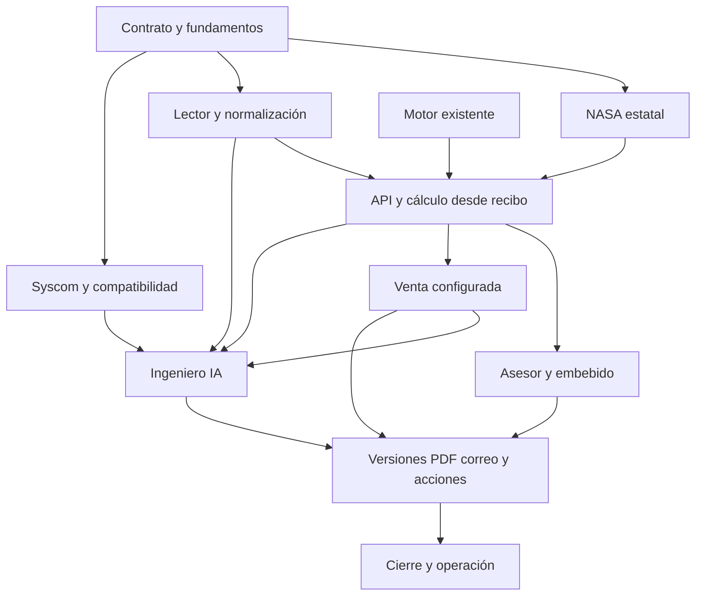

# Helios — Alcance, estado y orden de entrega

Fecha de revisión: 2026-10-27. Autor: Codex.

Este documento ordena el trabajo de todo el proyecto por dependencias reales.
El orden es una recomendación técnica para ejecutar las decisiones de producto
aceptadas; no acredita implementaciones ni convierte propuestas pendientes en
requisitos aprobados. Sustituye el orden histórico F1–F6 del backlog. Los RFC
conservan las reglas funcionales y los ADR sus decisiones técnicas.

## Producto que debemos entregar

Una instalación por empresa, con usuarios y permisos, configuración comercial,
CRM de prospectos y recepción privada de recibos. Una API de negocio compartida
procesa ambas entradas:

- Cliente: formulario embebido existente, contacto y recibo CFE. Sin captura
  manual de consumo o parámetros técnicos; correo obligatorio en el flujo final.
- Asesor: crea el prospecto y le sube el recibo. Sin proyecto obligatorio.

El recibo alimenta extracción validada, ubicación/entidad, HSP estatal NASA,
dimensionamiento determinista, selección de equipos, presupuesto y propuesta.
El asesor consulta costo de compra y precio de venta; el cliente solo venta.
Los costos ausentes se identifican como no disponibles, nunca como cero.

El objetivo completo de la primera entrega incluye Ingeniero IA, equipos reales
Syscom, validación eléctrica, perfiles de venta por kWp/panel/paquete,
descuentos, IVA, versiones, PDF, correo, acceso privado, acciones del cliente,
seguimiento y operación instalable. La instalación se cotiza por separado.
La calculadora genérica sin proveedor es un hito intermedio útil, no todo el
producto. No se necesitan credenciales Syscom para desarrollarla.

Primera ingeniería: interconexión CFE al 100% del consumo calculado. Aislado,
híbrido, otros proveedores, inventario por usuario, 3D, pagos, firma, reserva de
stock, aplicaciones nativas, billing y licenciamiento automático quedan fuera de
esta entrega. Google/contornos permanece pospuesto; no se vuelve bloqueo global.
Una API para consumidores externos con claves y webhooks se distingue de la API
compartida que necesitan ahora los dos formularios.

## Estado comprobado en el repositorio

Inventario local actualizado con servicios, rutas, guías de operación y cierres
registrados en MEMORY.md. No acredita despliegue ni auditoría completa de
seguridad. Esta reconciliación documental no ejecuta pruebas de aplicación.
Las validaciones de cada entrega conservan su fecha y alcance en la memoria.

| Área           | Existe                                                                                                            | Falta para cerrar                                                                                         |
| -------------- | ----------------------------------------------------------------------------------------------------------------- | --------------------------------------------------------------------------------------------------------- |
| Identidad      | Fortify, 2FA/passkeys, roles, usuarios y protección del último owner                                              | Auditoría integral de registro, sesiones, cuentas inactivas y permisos                                    |
| Empresa y tema | Configuración y vigencia; identidad Helios, tema claro y oscuro negro con acentos verdes, componentes compartidos | Identidad configurable por empresa y revisión visual individual de rutas restantes                        |
| CRM            | CRUD de prospectos/proyectos, duplicados y resumen operativo con permisos                                         | Bandeja completa, toma concurrente, historial y seguimiento                                               |
| Recepción      | CRM y embebido encolan análisis; archivo privado, consentimiento, progreso interno y segunda carga interna        | Recuperación y acciones públicas, recaptura pública completa y avisos                                     |
| Datos CFE      | Lector Ollama, contrato v1.0, normalización, evidencia y revisión versionada; OCR local eliminado                 | Completar lectura íntegra IA y evaluación PDF/fotografías; proveedor IA de producción                     |
| Ingeniería     | Motor, dimensionador manual y cálculo desde recibo con snapshot HSP NASA                                          | Potencia/modelo documentados para cantidades, validación eléctrica y API externa completa                 |
| Geografía      | Domicilio extraído y entidad confirmada manualmente para cálculo                                                  | Coordenadas verificadas, mapa y semáforo real; Google/contornos pospuesto                                 |
| NASA           | Catálogo real de 32 entidades, actualizador y snapshot consumido por cálculo                                      | Verificación operativa continua de vigencia y recuperación de actualizaciones                             |
| Equipos        | Adaptador API oficial Syscom, búsqueda y selección manual en borradores                                           | Selección IA, atributos y compatibilidad eléctrica completos, semántica comercial lista/MAP               |
| Economía       | Borrador interno con precio_lista congelado, IVA local 16% y total                                                | Perfiles kWp/panel/paquete, descuentos y configuración comercial completa; costo/utilidad verificables    |
| Propuestas     | Borradores internos de equipos versionados e idempotentes                                                         | Publicación comercial, PDF privado, correo, enlace y acciones del cliente                                 |
| Operación      | Migraciones, colas, CI y Swagger local documentado                                                                | Instalación/actualización, proveedor IA, workers/scheduler persistentes, respaldos, monitoreo y retención |

La integración local usa `ReceiveReceipt` y `ReadAndSizeReceipt`: carga, lectura,
revisión cuando corresponda, entidad confirmada y consulta HSP antes de guardar
el cálculo. El lector source fue eliminado; la lectura íntegra IA y su aceptación
por revisión condicional está solicitada, aún no implementada. No se inventa
potencia de panel para completar cantidades. Las respuestas del embebido no
incluyen una propuesta pública ni convierten cookies CRM en autorización.

Ver [análisis automático](automatic-receipt-analysis.md),
[cotizador asistido](assisted-quote.md), [contrato](contracts/solar-processing-v1.md)
y [ADR-016 de diseño](adrs/016-identidad-y-sistema-visual.md).
Estos avances no declaran cerrados E3–E10 ni el recorrido completo del RFC-001.

## Orden recomendado

Cada entrega incluye pruebas, documentación y la interfaz mínima necesaria para
usar o administrar lo construido. No se termina primero todo el frontend ni se
pospone toda la interfaz hasta el final. Los números son orden de ejecución
recomendado; las dependencias indican cuándo un área puede avanzar por separado.

| ID  | Entrega verificable                                           | Depende de                           | Desbloquea                                                              |
| --- | ------------------------------------------------------------- | ------------------------------------ | ----------------------------------------------------------------------- |
| E0  | Alinear alcance, documentos y estado real                     | Revisión actual                      | Un plan común; esta entrega es documental                               |
| E1  | Base operativa y contrato común de procesamiento/API          | E0                                   | NASA y lector independientes, estados seguros y consumidores coherentes |
| E2  | Catálogo estatal NASA real y versionado                       | E1                                   | HSP automático sin consulta por prospecto                               |
| E3  | Lectura real y normalización de recibos                       | E1; entorno de ejecución IA definido | Consumo, histórico y domicilio reales; puede desarrollarse sin E2       |
| E4  | API integrada de necesidades genéricas desde recibo           | E1, E2, E3 y motor existente         | Primer resultado técnico automático guardado sin Syscom                 |
| E5  | Consumo por asesor y embebido, correcciones y atención humana | E4; contratos de E1                  | Ambos recorridos completos hasta resultado técnico o derivación         |
| E6  | Precios de venta y configuración económica                    | E1; cálculo de E4 para integración   | Presupuesto de venta reproducible sin costo proveedor                   |
| E7  | Catálogo Syscom, costos y compatibilidad                      | E1; acceso/contrato proveedor        | Equipos reales válidos y costo interno; no bloquea E2–E6                |
| E8  | Ingeniero IA seleccionando con herramientas                   | E3, E4, E7; E6 para presupuesto      | Propuesta automática con equipos y justificación verificables           |
| E9  | Cotizaciones, versiones, publicación y entrega                | E5, E6, E8                           | PDF, correo, enlace privado y acciones sobre versión                    |
| E10 | Cierre integral de CRM, frontend y operación                  | E1–E9                                | Primera entrega de producto lista para instalar y operar                |

### E1 — Fundamentos que evitan rehacer el flujo

Estado: cerrada el 2026-10-23. Runtime/contrato/persistencia/cola y pruebas
completados; migración aplicada en MySQL local. Instalación nueva con las 171
dependencias (incluidas dev), package discovery, migraciones y 235 pruebas
verificados en carpeta y base aisladas. Registro de validaciones en MEMORY.md.
Las rutas HTTP, lector real y notificaciones conservan su entrega E3–E5.

- Runtime/CI alineados por E1: Composer exige PHP ^8.4.1 y CI instala 8.4;
  anteriormente ambos declaraban 8.3 pese al lock. Probar instalación limpia antes de
  atribuir compatibilidad al proyecto. Elegir runtime compatible; no actualizar
  dependencias indiscriminadamente.
- Diseñar contrato versionado de recepción, progreso, corrección y resultado
  compartido, con ejemplos/errores y separación de respuesta pública/interna.
  Especificar límites de autenticación; no dar privilegios por un campo `role`
  o `audience` enviado por el navegador.
- Persistir expediente, intentos, procesamiento y auditoría base. Distinguir
  import, calidad geográfica, cálculo, publicación y entrega. Definir reintentos
  y deduplicación de acciones, sin perder solicitudes legítimas ni fusionar leads.
- Preparar cola sobre base, ejecución después del commit, errores observables y
  puntos de reanudación. Un reintento no consume otra carga ni crea otra propuesta.
- Definir contratos de lector, HSP, resultado genérico y precios no disponibles.
  En el cierre inicial E1 el lector solo tenía `readFixture`; esa limitación
  fue sustituida por los lectores reales de E3.
- Definir responsable/bandeja y notificaciones como parte del expediente; su
  interfaz completa se entrega en E5. No prometer un procesamiento activo si
  faltan lectores o workers.

Cierre: contratos y estados probados con fixtures explícitas, sin costo interno
ni PII en respuestas públicas, runtime/CI coherentes y migraciones probadas en
base aislada. Las fixtures no habilitan propuesta comercial.

### E2 — NASA antes del recorrido automático

Estado: cerrada y publicada localmente el 2026-10-23. 32 entidades, valores
reales NASA, pesos territoriales INEGI, evidencia/versiones, actualización,
caducidad y pruebas de fallos. Ver [metodología y operación](hsp-catalog.md).

Implementar como servicio separado del lector y del formulario. Primero validar
una respuesta real y las unidades; después metodología estatal, catálogo y
actualización, conforme ADR-014. Documentar fuente de límites estatales, período,
malla/puntos, ponderación/agregación, conversión, frecuencia y caducidad.
No reemplazar promedios estatales con datos de las capitales ni usar 5.0 oculto.

Cierre: 32 entidades con valores verificables, fuente/evidencia/versiones,
consulta local por entidad y pruebas de actualización fallida conservando la
última versión válida. No depende de IA, recibos ni credenciales Syscom.

### E3 — Recibo real, validado y corregible

Estado al 2026-10-27: implementado parcialmente con Ollama, normalización y revisión versionada. Source/OCR local eliminados. Pendientes lectura íntegra IA, evaluación ampliada y operación del proveedor de producción.

Definir dónde ejecutará el lector, hardware/modelo/formato soportado y límites
antes de elegir modelo. El contrato CFE actual prohíbe enviar datos personales a
terceros; no sustituirlo por un servicio remoto sin decisión expresa.

Recibir archivo privado, extraer JSON v1.0, validar, conservar original y evidencia,
normalizar consumo/histórico y registrar correcciones/aceptación por asesor.
Distinguir ilegibilidad, dato no impreso y fallo técnico. Preparar dos cargas
máximas por legibilidad en el mismo expediente, sin contar fallos de servicio.
Resolver entidad del suministro sin inferir coordenadas ni confundir dirección
extraída con sitio confirmado. Ubicación/corrección son datos separados del JSON.

Cierre: muestras autorizadas legibles, parciales e ilegibles probadas, sin
inferencias silenciosas ni aceptación automática de un JSON solo estructuralmente
válido. El módulo puede probarse antes de NASA; la integración automática espera E2.

### E4 — Primera API útil sin catálogo proveedor

Estado al 2026-10-27: cálculo interno desde recibo y snapshot NASA implementados. No equivale a cierre de API completa ni a cantidades de equipos sin potencia documentada.

Componer recibo validado, entidad aceptada, HSP versionada y motor existente.
Persistir entradas/supuestos, versiones y resultado de cada cálculo. Resolver
la normalización histórica sin perder días ni cambiar fórmulas Syscom de forma
implícita. La ubicación necesita una vía manual válida cuando Google está pospuesto;
una fixture geográfica no habilita resultados reales.

La cantidad de paneles necesita potencia por panel. Acordar y registrar su fuente
como parámetro técnico de referencia de la empresa o de evaluación, no asumir
550 W ni pedirla al cliente. Devolver cantidad, watts por panel, kWp, inversor
mínimo en kW y alternativa de microinversores solo con capacidad documentada.
Sin catálogo no atribuir marca, stock, precio de compra ni compatibilidad completa.

Cierre: API JSON documentada y probada desde archivo hasta resultado técnico o
bloqueo explicado; mismo cálculo para mismas entradas. Cliente y asesor tienen
proyecciones autorizadas distintas; costo y venta ausentes no se vuelven cero.
Es un dimensionamiento preliminar, no publicación comercial completa.

### E5 — Usar el resultado en los dos canales

Estado al 2026-10-27: ambas cargas disparan procesamiento y el CRM muestra progreso/revisión. Acciones públicas, recuperación, bandeja y avisos completos pendientes.

Conectar primero la carga dentro del prospecto del asesor, luego el formulario
embebido existente. Ambos usan el contrato y caso de uso comunes. Preservar
CSRF del CRM y aislamiento sin sesión del embebido; no convertir cookies CRM
en acceso interno desde el iframe público.

Mostrar progreso real, resultado genérico, faltantes, recaptura y confirmación de
ubicación en el mismo recorrido. No añadir al cliente un formulario técnico.
Completar bandeja, responsable existente, toma atómica, aviso al administrador,
seguimiento y recordatorio único por abandono con recuperación del expediente.
Los plazos son configurables y explícitos, sin SLA inventado.

Cierre: dos recorridos en navegador, escritorio/móvil, con permisos, segunda
carga, datos faltantes, reintentos, abandono y derivación probados. No enviar
una propuesta comercial desde datos de prueba ni por ausencia de tarifa.

### E6 — Venta propia independiente de costo Syscom

Estado al 2026-10-27: precio_lista e IVA local 16% disponibles en borrador asistido. Perfiles propios y descuentos de esta entrega siguen pendientes.

Perfiles versionados por kWp, panel y paquete con condiciones, prioridad,
moneda, vigencia e inclusiones. Captura sin IVA ni instalación. Dinero en
centavos, IVA configurado/verificado y descuentos según RFC-001.
Antes de descuentos por concepto, definir importes/base de cada concepto dentro
de perfiles por paquete/kWp/panel; una lista de inclusiones no define su valor.
No fijar repartos arbitrarios para poder descontar.

Cierre: configurador CRM y motor probados, sin doble base ni IVA duplicado;
subtotal/IVA/total reproducibles, leyenda de instalación, ausencia/conflicto de
perfil deriva a asesor sin cifra pública. Sin costo real no se calcula utilidad.
E6 puede construirse con resultados de prueba mientras se integra E4.

### E7 — Equipos y costos reales

Estado al 2026-10-27: API oficial y selección manual implementadas; no acreditan compatibilidad eléctrica ni costo de compra/utilidad. Semántica lista/MAP pendiente.

Revalidar endpoints, cobertura y credenciales Syscom; precio de compra exige
su fuente real. Normalizar atributos y conservar ausencias explícitas; agregar
stock por cantidad, consulta/frescura/caché y fallos. Validar eléctricamente
antes de declarar viable una configuración. Cableado, estructura y protecciones
no se dimensionan como “una pieza” copiando la tabla de la referencia.

Cierre: contrato real con evidencia, candidatos compatibles, disponibilidad
suficiente para entrega automática, bajo pedido identificado para asesor y
costos internos fuera de toda respuesta/PDF público. Sin acceso al proveedor,
pruebas del adaptador siguen posibles; equipos/costos reales quedan bloqueados.

### E8 — Ingeniero IA con autoridad limitada

Estado al 2026-10-27: selección automática de equipos con herramientas pendiente; no confundir el lector con el Ingeniero IA.

El lector y el Ingeniero IA son responsabilidades distintas. El primero extrae;
el segundo analiza contexto y elige configuraciones. Exponer herramientas de
cálculo/catálogo/compatibilidad/precios ya probadas. Rechazar IDs inexistentes,
cifras inventadas, equipos incompatibles y uso de stock desconocido como disponible.

Cierre: selección justificada con evidencia y herramientas, alternativas y
trazabilidad, sin sustituir la decisión del Ingeniero IA con un ranking fijo.
La API integra este resultado sin cambiar el formulario de contacto/archivo.

### E9 — Cotización y entrega completa

Estado al 2026-10-27: existen borradores internos versionados; publicación, PDF/correo y acceso del cliente siguen pendientes.

Borrador y versiones inmutables con snapshots, edición autorizada y publicación
explícita de actualizaciones. Acceso revocable por versión, vencimiento comercial
separado del enlace y revocación de la versión sustituida. PDF privado con
identidad de empresa y precio cliente; costo de compra solo para asesor.

Correo, generación PDF y publicación con estados independientes e idempotencia.
Acciones contacto/cambios/aceptación y solicitud de actualización al vencer.
Página neutra y contacto al revocar. Preservar historial y aceptaciones internas.

Cierre: ambos recorridos terminan en entrega válida o atención humana, con PDF,
correo y acceso privado probados; fallar/reintentar envío no duplica versiones.

### E10 — Cerrar el producto, no solo sus pantallas

- Dashboard con expedientes/propuestas/pendientes reales; historial auditado y
  navegación funcional. Proyectos internos siguen opcionales, sin trabajo de CRM
  genérico fuera del recorrido solar.
- Configuración coherente de empresa, tarifas/IVA, lector, NASA, proveedor,
  plazos, identidad y textos de propuesta; permisos por operación.
- Revisión de acceso por sesión, registro, passkeys, usuarios inactivos, archivos,
  datos personales y exclusión efectiva de costos internos en salidas públicas.
- Instalación/actualización idempotente, requisitos y README operativo; respaldo
  y restauración probados. Migraciones preservan historial y datos del comprador.
- Workers/scheduler/caché/SMTP y almacenamiento documentados; monitoreo de
  trabajos fallidos, notificaciones, retención y reconciliación de archivos.
- Pruebas unitarias, integración, contratos, permisos y recorridos en navegador,
  además de Pint, PHPStan, TypeScript, lint, build y aislop sin bloqueantes.

Cierre: instalación limpia y actualización probadas; un asesor y un cliente
recorren el flujo real sin fixtures, sin acceso cruzado y con fallos recuperables.
No considerar “listo” por compilar, pasar pruebas de servidor o generar un PDF
estático de junta. La puesta en producción requiere configuración real aprobada.

## Dependencias que importan

NASA y lector pueden desarrollarse independientemente después de fijar sus
contratos; elegir NASA primero evita esperar por hardware/modelo del lector.
Syscom no bloquea la calculadora genérica ni las tarifas de venta propias.
El costo de compra sí bloquea márgenes/utilidad y un presupuesto interno con
costo real. La falta de tarifas CFE bloquea ahorro/retorno, no cantidad de paneles
ni venta de equipos según perfiles. No prometer ahorro ni retorno sin fuentes.

## Ampliaciones con su propio cierre

- RFC-002: Google/geocodificación y contornos, con consentimiento/tratamiento,
  proveedor, costos, cobertura y criterios reales validados. No activar Google
  ni exigir tarjeta como prerrequisito global. La captura manual permite avanzar.
- API externa F6: consumidores externos, autenticación, OpenAPI, límites y
  webhooks según necesidad; fuera del contrato público limitado al expediente.
- Ingeniería adicional: aislado/híbrido, producción/ahorro/retorno y fuentes de
  tarifas/compensación; requieren especificaciones y validaciones propias.
- Multiproveedor/inventario y licenciamiento: evolución, no infraestructura a
  construir anticipadamente.

## Próxima unidad de trabajo

Completar el lector IA y aplicar la revisión
condicional solicitada, con evidencia y validaciones deterministas. No se
considera autorizada la aceptación de extracciones ambiguas por este documento.
Después, cerrar evaluación/operación del lector y completar ingeniería de
equipos, compatibilidad y selección asistida por IA antes de publicación.

Los hitos E1/E2 permanecen implementados. E3–E7 tienen avances locales parciales;
E8/E9 y el cierre integral E10 no están completados. Mantener los criterios
anteriores como trabajo restante, sin reinterpretarlos como funciones existentes.
